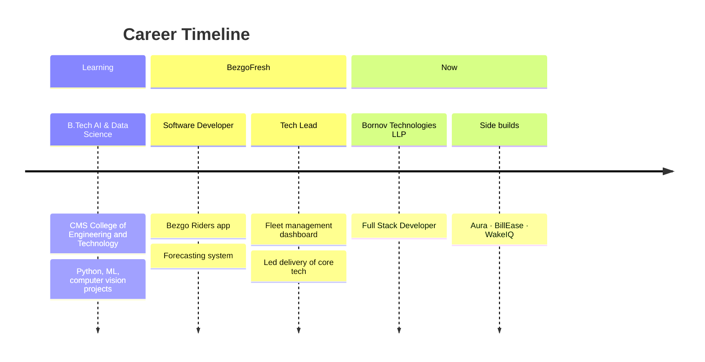
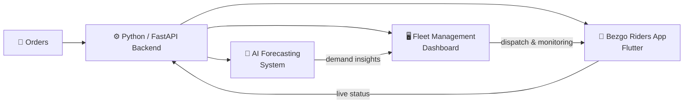

<!-- ═══════════════════════════ HEADER ═══════════════════════════ -->
<div align="center">


<a href="https://git.io/typing-svg">
  
</a>

<br/>

<a href="https://portfolioparthiv.vercel.app"></a>
<a href="https://github.com/tenzuki"></a>
<a href="https://instagram.com/p_.arthiv.sensei"></a>
<a href="mailto:YOUR_EMAIL_HERE"></a>
<a href="https://www.linkedin.com/in/YOUR_LINKEDIN_HERE"></a>

<br/><br/>


<br/><br/>

<b>
<a href="#-whoami">About</a> ·
<a href="#-career-log">Career</a> ·
<a href="#-bezgofresh--what-i-built">BezgoFresh</a> ·
<a href="#-tech-arsenal">Stack</a> ·
<a href="#-featured-projects">Projects</a> ·
<a href="#-github-analytics">Stats</a> ·
<a href="#-lets-build-something">Contact</a>
</b>

</div>


<!-- ═══════════════════════════ ABOUT ═══════════════════════════ -->
## 👾 &nbsp;`whoami`

<table>
<tr>
<td width="62%" valign="top">

```python
class Partho:
    name       = "Parthiv K"
    role       = "Full Stack Developer @ Bornov Technologies LLP"
    previously = "Software Developer → Tech Lead @ BezgoFresh"
    education  = "B.Tech, AI & Data Science · CMS College of Engineering and Technology"
    location   = "Kerala, India"
    stack      = ["Flutter", "Python", "FastAPI", "PyTorch", "TensorFlow"]
    philosophy = "Build from scratch. Understand every layer."

    def currently(self):
        return [
            "🚀 shipping full stack products at Bornov Technologies",
            "🧠 building Aura — a fully offline desktop AI assistant",
            "👁️ exploring computer vision & on-device LLMs",
            "🧾 designing BillEase — billing SaaS for kirana stores",
        ]

    def ask_me_about(self):
        return ["Flutter", "Python", "FastAPI", "ML forecasting",
                "Fleet & delivery tech", "Computer Vision"]
```

</td>
<td width="38%" align="center" valign="middle">


</td>
</tr>
</table>


<!-- ═══════════════════════════ CAREER ═══════════════════════════ -->
## 🧭 &nbsp;Career Log

<table>
<tr>
<td width="50%" valign="top">

### 🟢 Bornov Technologies LLP
**Full Stack Developer** &nbsp;·&nbsp; `Present`

Building and shipping end-to-end features across mobile, web and backend.

- 🔹 Designing and building **full stack products**: UI, APIs and data layer
- 🔹 _Add your key projects here_
- 🔹 _Add a result or metric here_


</td>
<td width="50%" valign="top">

### 🟣 BezgoFresh · OGZEB Ventures Pvt Ltd
**Software Developer → Tech Lead** &nbsp;·&nbsp; `~1.5 years` &nbsp;·&nbsp; Palakkad

Owned the technology behind delivery, fleet operations and business forecasting.

- 🔹 Shipped the **Bezgo Riders** delivery app
- 🔹 Built a **fleet management dashboard**
- 🔹 Built an **AI-powered forecasting system**
- 🔹 Stepped up to **Tech Lead**


</td>
</tr>
</table>




<!-- ═══════════════════════════ BEZGOFRESH ═══════════════════════════ -->
## 🛵 &nbsp;BezgoFresh — What I Built

> **BezgoFresh** is a fresh-delivery business under OGZEB Ventures Pvt Ltd. As Software Developer and later **Tech Lead**, I built the systems that move orders, riders and decisions.



<table>
<tr>
<td width="33%" valign="top">

### 📱 Bezgo Riders
**Flutter delivery app**

The rider-side app for day-to-day delivery work.

- Rider workflows & order handling
- Built in **Flutter** for a smooth mobile experience
- Connected to the Python backend

</td>
<td width="33%" valign="top">

### 🖥️ Fleet Dashboard
**Operations command centre**

A management dashboard for keeping the fleet organised and visible.

- Fleet & rider oversight
- Operational visibility for the team
- Shipped while leading tech

</td>
<td width="33%" valign="top">

### 🧠 AI Forecasting
**Business forecasting system**

Machine learning that turns history into planning.

- Random Forest based forecasts
- Built with **Python, Pandas, scikit-learn**
- Supports business planning decisions

</td>
</tr>
</table>

<details>
<summary><b>🏅 Impact & leadership highlights (click to expand)</b></summary>
<br/>

| Area | Contribution |
|---|---|
| 👑 **Leadership** | Grew from Software Developer to **Tech Lead** within ~1.5 years |
| 📱 **Mobile** | Designed, built and shipped the **Bezgo Riders** Flutter app |
| 🧠 **AI / ML** | Delivered an end-to-end **forecasting system** used for business planning |
| 🖥️ **Internal tools** | Built the **fleet management dashboard** for operations |
| 🧩 **Architecture** | Python + FastAPI backends with Flutter frontends across products |
| 📊 **Results** | _Add your numbers, e.g. "X riders onboarded", "Y% forecast accuracy", "Z deliveries/day"_ |

</details>


<!-- ═══════════════════════════ TECH STACK ═══════════════════════════ -->
## 🛠️ &nbsp;Tech Arsenal

<div align="center">

### 📱 Frontend & Mobile


### ⚙️ Backend & Databases


### 🧠 AI / ML / Data


### 🧰 Tools & DevOps


### 🔌 IoT & Hardware


<br/>


</div>


<!-- ═══════════════════════════ FEATURED PROJECTS ═══════════════════════════ -->
## 🚀 &nbsp;Featured Projects

<table>
<tr>
<td width="50%" valign="top">

### 🤖 Aura — Offline Desktop AI Assistant
> *A fully local, Jarvis-style system agent. No cloud. No leaks.*

Runs entirely on-device with **Ollama + Gemma** as the brain, a **FastAPI** orchestrator, a **Flutter desktop** frontend with generative UI, and **SQLite** persistence. Includes a custom Python tool layer and a **Safety Gate** that guards destructive tool calls.


</td>
<td width="50%" valign="top">

### 🧾 BillEase — Billing SaaS for Kirana Stores
> *Offline-first billing built for Kerala's neighbourhood shops.*

Multi-tenant SaaS architecture with an offline-first mobile client (**Drift + Riverpod**), **Supabase** backend and **Razorpay** payments. [Live prototype →](https://bill-ease-sans-tension.lovable.app)


</td>
</tr>
<tr>
<td width="50%" valign="top">

### ⏰ WakeIQ — Smart Alarm App
> *Live on the Google Play Store.*

A published Android alarm app built with Flutter and used by real people every morning.


</td>
<td width="50%" valign="top">

### 👁️ Computer Vision Lab
> *AI-Powered Mouse · AI Smart Camera · AI Virtual Keyboard*

Gesture and vision-driven interfaces: control your cursor with your hand, type on a virtual keyboard in mid-air, and smart-camera automation.


</td>
</tr>
</table>

<details>
<summary><b>🧪 More experiments (click to expand)</b></summary>
<br/>

| Project | What it is | Tech |
|---|---|---|
| 🧊 **Smart IoT Refrigerator** | DIY fridge with a Peltier cooling module and a desktop control app | ESP32 · CustomTkinter |
| 🌡️ **Temp & Humidity Monitor** | Full-featured GUI dashboard over live sensor data | Arduino · Python |
| 🛒 **Sales POS** | Van-sales point-of-sale machine test project | [github.com/tenzuki/Sales_POS](https://github.com/tenzuki/Sales_POS) |
| 📡 **NearDrop** *(concept)* | Cross-platform local file transfer | Flutter |
| 🎮 **TapRush** *(concept)* | Casual mobile game with ad monetization | Flutter · AdMob |

</details>


<!-- ═══════════════════════════ STATS ═══════════════════════════ -->
## 📊 &nbsp;GitHub Analytics

<div align="center">


<br/>


<br/>


<br/><br/>

### 🐍 Contribution Snake
<picture>
  <source media="(prefers-color-scheme: dark)" srcset="https://raw.githubusercontent.com/tenzuki/tenzuki/output/github-contribution-grid-snake-dark.svg" />
  <source media="(prefers-color-scheme: light)" srcset="https://raw.githubusercontent.com/tenzuki/tenzuki/output/github-contribution-grid-snake.svg" />
  
</picture>

</div>

### 🏆 Trophy Case
<div align="center">


</div>


<!-- ═══════════════════════════ FOOTER ═══════════════════════════ -->
## 🤝 &nbsp;Let's Build Something

<div align="center">

**Got an app idea, an AI problem, or a team that needs a full stack person who lives in Flutter + Python?**
I'd love to hear about it.

<a href="https://portfolioparthiv.vercel.app"></a>
<a href="mailto:YOUR_EMAIL_HERE"></a>

<br/><br/>


<br/>


<sub>⚡ Crafted with caffeine, Flutter & Python · Kerala, India 🌴</sub>

</div>
